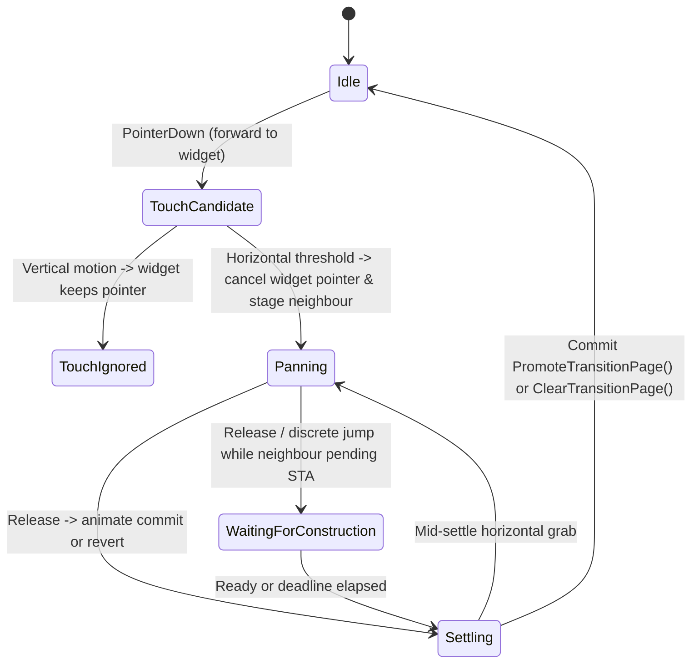

# Explicit state machines and lifetime safety across RedXe

## Metadata

- **Status**: `ACTIVE` (Plan only — zero production code, ABI, shader, or build changes in this PR)
- **Date**: 2026-11-10
- **Baseline commit**: `cde3877c88a4fb25cc42014aeee41ac2469f1dac` (`origin/main`)
- **Authoritative contracts to reconcile on closeout**:
  - [Specs/README.md](../../README.md)
  - [Specs/UI/UI_Dashboard.md](../../UI/UI_Dashboard.md)
  - [Specs/UI/UI_XeneonDisplayWindowing.md](../../UI/UI_XeneonDisplayWindowing.md)
  - [Specs/Core/Core_Settings.md](../../Core/Core_Settings.md)
  - [Specs/Core/Core_PerformanceAndResources.md](../../Core/Core_PerformanceAndResources.md)
  - [Specs/Core/Core_DxUiIntegration.md](../../Core/Core_DxUiIntegration.md)
  - [Specs/Plugins/Plugins_API.md](../../Plugins/Plugins_API.md)
  - [Specs/Plugins/Plugins_AVControl.md](../../Plugins/Plugins_AVControl.md)
  - [Specs/Plugins/Plugins_Logicon.md](../../Plugins/Plugins_Logicon.md)
  - [Specs/Plugins/Plugins_Weather.md](../../Plugins/Plugins_Weather.md)
  - [Specs/Plugins/Plugins_Actions.md](../../Plugins/Plugins_Actions.md)
  - [Specs/Build/Build_Process.md](../../Build/Build_Process.md)
  - [Specs/Build/Build_TestRunEvidence.md](../../Build/Build_TestRunEvidence.md)
  - [Specs/Build/Build_UnifiedCI.md](../../Build/Build_UnifiedCI.md)
- **Related active plans**:
  - [PluginBoundaryHardening_2026-09-03.md](PluginBoundaryHardening_2026-09-03.md) (G2 gesture extraction in `Application.cpp` aligns directly with Slice 1)
  - [RFC_Plugins_AVControl.md](RFC_Plugins_AVControl.md) (retains real hardware/IME/accessibility release gates)

---

## Context and motivation

An organization-wide read-only audit of implicit state machines across the `RedSalamanders` repositories identified **27 implicit state machines** in RedXe (`11` in `RedXe/` host and plugin runtime, `13` across bundled `Plugins/` and `RedXeLauncher/`, and `3` in `Build/*.psm1` PowerShell tooling) together with **24 concrete bugs and state-transition hazards** (`RX-SM-01` through `RX-SM-24`).

Converting multi-boolean/sentinel/pointer state clusters into explicit `enum class` phases, `std::variant` controller states, transactional resource swaps, and mutex-fenced build receipts elevates all three engineering dimensions without breaking RedXe's COM/POD plugin ABI, settings JSON schema, or steady-state zero-allocation rendering:

1. **User Experience (UX)**: Fixes blurry Tier-1 `1024x1024` `DeskClock` glyphs on 4K/high-DPI tiles at startup, eliminates `SystemData` disk throughput/active-% spikes after cancelled batches and stack-buffer corruption hazards on slow driver IOCTLs, restores `Weather` automatic location recovery and city persistence, prevents `AVControl` hotplug privacy auto-disable drops and `SuspendObservation` races, and allows `widget.dismiss` / `Escape` to reverse an in-progress widget raise smoothly.
2. **Developer Experience (DX)**: Collapses 14-field swipe navigation tuples, 3-class mirrored widget-raise state, 14-boolean `ProcessViewer` pipelines, and ad-hoc COM/GDI cleanup paths into self-contained state controllers with single transition authorities.
3. **Agent Experience (AX)**: Eliminates hidden cross-method invariants (`!_initialized` meaning "time sampled" rather than "device attached", or `Test-Changes.ps1` exiting `0` when mid-run edits invalidate receipts) so static readers and automated gates observe unambiguous state types.

---

## Non-breaking invariants

Every implementation slice executing this plan MUST uphold [AGENTS.md](../../../AGENTS.md) and [Core_PerformanceAndResources.md](../../Core/Core_PerformanceAndResources.md):

1. **Public COM/POD ABI stability**: Preserve all `sizeof` and `offsetof` assertions in `Common/PlugInterfaces/*.h`, sibling `QueryInterface` contracts, and normalized JSON settings schemas (`Settings/RedXe*.settings.json`, `Specs/Settings.schema.json`).
2. **Zero-allocation GPU `Render` and event-blocked idle**: `Render`, visibility, and paint callbacks remain nonblocking and heap-free; idle, occluded, hidden, and minimized states block on OS events with zero busy polling.
3. **Strict WIL RAII, exception, and `/Wall` discipline**: Zero warnings across `(x64, ARM64) x (Debug, Release, ASan Debug)`, WIL ownership for every COM/Win32 handle (no manual `Release` or `catch (...)` — including removing the stray `catch (...)` in [CameraSetup.cpp](../../../Plugins/AVControl/Camera/CameraSetup.cpp) L93), and no terminating running `RedXe.exe` outputs.
4. **Pinned `DxUi.lib` boundary**: Keep `DxUi` C++ inside `RedXe.exe` / isolated consumer targets at the exact commit in `Dependencies/DxUi.lock.json`.

---

## Verified defect ledger (`RX-SM-01` .. `RX-SM-24`)

| ID | Severity | Location | Verified failure mode | Slice |
| --- | --- | --- | --- | --- |
| `RX-SM-01` | Medium | [Application.h](../../../RedXe/Application.h) L473–475, L562–592; [Application.cpp](../../../RedXe/Application.cpp) L4479, L4570, L4748–4773, L6216–6220, L7027 | 9 booleans + 2 direction ints + 3 pointers encode 7 swipe states with divergent "in-progress" predicates (`PageNavigationInProgress` vs `OnSize` vs `HostFrameState`); grabbing an active settle (`_pageSettleActive = false`) and then rejecting touch as vertical resumes settle with a stale `_pageSettleCommit`. | Slice 1 |
| `RX-SM-02` | Medium | [Application.h](../../../RedXe/Application.h) L593–607; [Application.cpp](../../../RedXe/Application.cpp) L4081, L5604–5860; [DashboardHost.h](../../../RedXe/DashboardHost.h) L103; [Renderer.h](../../../RedXe/Renderer.h) L173–177 | `_raisedActive` stays `true` during `Dismissing` (reporting `RedXeHostStateRaised` while closing), `widget.dismiss` silently no-ops during `Raising` because `OverlayMotionInProgress()` sets `busy`, and 3 classes manually mirror `(active, index, rect)`. | Slice 1 |
| `RX-SM-03` | Medium | [Application.h](../../../RedXe/Application.h) L207, L502–544, L612–616; [Application.cpp](../../../RedXe/Application.cpp) L5194–5208, L5864–5920; [PluginHost.h](../../../RedXe/PluginHost.h) L451 | `OnSettingsChanged()` has asymmetric deferral (`_inSizeMove` leaves `SettingsWatcher` unacknowledged, whereas `IsIconic` acknowledges and loads into `_deferredStamp` without marking applied/rejected); `DockHidden()` relies on `_dockSlideActive` never desynchronizing from `_dockReveal`; `PluginHost::ServiceSlot::laneRunning` is dead state. | Slice 1 |
| `RX-SM-04` | High | [DeskClock.cpp](../../../Plugins/DeskClock/DeskClock.cpp) L1023, L1250–1290, L1422, L1488, L1588, L1735; [Renderer.cpp](../../../RedXe/Renderer.cpp) L918–927, L1019–1039 | `OnTargetSizeChanged` gates on `!_initialized` (set only on first `Render()`) instead of device attachment, skipping `EnsureAtlasScale` during startup/device-loss setup and trapping large/4K tiles at blurry Tier-1 `1024x1024` glyphs; upgrading `_atlasScale` leaves `targetSize[3]` (`AtlasEdgePixels`) stale in the constant buffer; sibling widgets share unrefcounted `DeskClockDeviceResources`; `RedXePluginShutdown` omits `gTestTime = 0`. | Slice 2 |
| `RX-SM-05` | Low | [StudioClock.cpp](../../../Plugins/StudioClock/StudioClock.cpp) L693–715, L740–774 | Calling `OnDeviceCreated` while `_deviceAttached == true` increments `StudioClockSharedResources::_users` twice under a single boolean, leaking shared D3D resources on `OnDeviceLost`; `GetNextFrameDelayMilliseconds` mutates `_time`, `_hasTime`, and `_constantsDirty` during schedule queries. | Slice 2 |
| `RX-SM-06` | High | [GpuQuery.cpp](../../../Plugins/SystemData/GpuQuery.cpp) L335–355, L414–425, L484–490 | `RedXeGpuState::~RedXeGpuState` releases `dxcoreFactory` and calls `FreeLibrary(dxcoreModule)` without calling `ReleaseDxcoreAdapters(*this)`, leaking every live `IDXCoreAdapter1*` COM object and unloading `dxcore.dll` while unreleased instances exist. | Slice 3 |
| `RX-SM-07` | High | [SystemData.cpp](../../../Plugins/SystemData/SystemData.cpp) L2221–2232, L2259–2264, L2282–2287, L3386, L3447–3490; [NetStorage.cpp](../../../Plugins/SystemData/NetStorage.cpp) L801–808, L864–873 | `RestoreExternalRateHistory` rolls back `previousQpc`/`hasPreviousPerformance` without rolling back `bytesRead`, `bytesWritten`, `idleTime100ns`, or `skipPerformance*`, dividing 1-interval counter deltas by 2-interval elapsed QPC on the next batch and spiking disk `activePercent`; `CollectGpuEngines` discards computed `utilizationPercent` and omits the NPU class filter. | Slice 3 |
| `RX-SM-08` | High | [NetStorage.cpp](../../../Plugins/SystemData/NetStorage.cpp) L157–184; [PowerSensors.cpp](../../../Plugins/SystemData/PowerSensors.cpp) L79–106 | `DeviceIoctl` passes stack-allocated `OVERLAPPED` and output buffers to `DeviceIoControl` and returns even if `WaitForSingleObject(state.ioctlEvent, 1000)` after `CancelIoEx` times out—exposing popped stack memory and shared `ioctlEvent` to late kernel IRP completion. | Slice 3 |
| `RX-SM-09` | Medium | [ProcessViewer.cpp](../../../Plugins/ProcessViewer/ProcessViewer.cpp) L1232–1250, L1280–1284, L1432–1435, L1509–1594, L1686, L2595–2612; [ViewerGpu.cpp](../../../Plugins/ProcessViewer/ViewerGpu.cpp) L549–576 | Unraised `SystemPulse` leaves non-eased `display[4]` (RAM %) stale and `SetRaised(TRUE)` omits `_snapNextFrame = true`; shared 441-cell `_dynamicCursor` evicts sibling widgets' glyphs without invalidating their `_paintReady`; `_pidNames[32]` never evicts exited PIDs; partial `SetVisible(TRUE)` failure latches `_visible = true`. | Slice 3 |
| `RX-SM-10` | Medium | [Coordinator.cpp](../../../Plugins/AVControl/Coordinator.cpp) L104–122, L180, L431 | `SetSubscriberVisible(false)` while `_inFlight` sets `_stopRequested = true`; a subsequent `SetSubscriberVisible(true)` before worker completion does not clear `_stopRequested`, so `Complete() -> Schedule()` suspends observation and stops the broker while `_visible == 1`. | Slice 4 |
| `RX-SM-11` | Medium | [WindowsAudioBackend.cpp](../../../Plugins/AVControl/WindowsAudioBackend.cpp) L495–511; [BrokerMain.cpp](../../../Plugins/AVControl/BrokerMain.cpp) L266–272, L324–356 | `InitializeWithEnumerator` commits `_state->enumerator` before `RegisterEndpointNotificationCallback`, latching `ERROR_ALREADY_INITIALIZED` on retry while running deaf to hotplug; failed `windows->Initialize` in `BrokerMain` leaves `windows != nullptr` returning `Availability::Unknown`; `SuspendObservation` resets `AudioRevisionState` to `1` within the same broker session. | Slice 4 |
| `RX-SM-12` | Medium | [WindowsCameraBackend.cpp](../../../Plugins/AVControl/WindowsCameraBackend.cpp) L214–230, L275–290; [CameraRegistration.cpp](../../../Plugins/AVControl/Camera/CameraRegistration.cpp) L139–140; [CameraSetup.cpp](../../../Plugins/AVControl/Camera/CameraSetup.cpp) L93 | Advancing `observedSelectedChanges` before `controller->Enable(false, ...)` drops hotplug privacy auto-disable if `Enable(false)` transiently returns `E_PENDING`; `VirtualCameraRoute::Remove` leaves partial state on failure; `CameraSetup.cpp` uses forbidden `catch (...)`. | Slice 4 |
| `RX-SM-13` | Medium | [CameraController.cpp](../../../Plugins/AVControl/Camera/CameraController.cpp) L108–109, L144–168, L189–202 | A 2500 ms `WaitForSingleObject` timeout in `CameraController::Change` leaves `_request != _done` wedged in `E_PENDING` and skips `_bridge.Stop()` when disabling; `Fail()` ignores `_bridge.SetGate` failure while publishing confirmed-Off. | Slice 4 |
| `RX-SM-14` | Medium | [CameraMediaSource.cpp](../../../Plugins/AVControl/Camera/CameraMediaSource.cpp) L220–243, L493–509; [CameraFrameChannel.cpp](../../../Plugins/AVControl/Camera/CameraFrameChannel.cpp) L85–91 | `Stream::Start` while already `MF_STREAM_STATE_RUNNING` omits required `MEStreamStarted`; partial `Start()` failure leaves `Stream` `RUNNING` while `Source::_started == false` (`Stop()` becomes a no-op); `WAIT_ABANDONED` recovery in `FrameChannel::Lock` omits bumping `revision` and scrubbing `image`. | Slice 4 |
| `RX-SM-15` | Low | [AVControl.cpp](../../../Plugins/AVControl/AVControl.cpp) L571–574 | `ViewCommandKind::OpenProfiles` while unraised sets `_openProfilesOnRaise = true`; if the host refuses `RedXePointerRaise`, `_openProfilesOnRaise` stays latched until manual close. | Slice 4 |
| `RX-SM-16` | Low | [LogiconService.cpp](../../../Plugins/Logicon/LogiconService.cpp) L1454–1492, L1599–1604; [LogiconDevice.h](../../../Plugins/Logicon/LogiconDevice.h) L165–181 | Dialpad disconnect path calls `CloseDialpad()` without clearing `_dialpadPresent = false`; `Link` and `DeviceSession` encode 4–5 states via boolean/counter tuples. | Slice 5 |
| `RX-SM-17` | Medium | [Weather.cpp](../../../Plugins/Weather/Weather.cpp) L868–944, L1435–1460 | Transient `WeatherLocation.exe` timeout/unavailable on startup latches `_locationAttempted = true` permanently, blocking automatic location retries for the process lifetime; reverse-geocoding failure on first refresh latches `_locationResolved = true` and persists an empty city, preventing later city persistence when reverse geocoding succeeds. | Slice 5 |
| `RX-SM-18` | Medium | [Shaders.cpp](../../../Plugins/5H4D3R5/Shaders.cpp) L1357–1362, L1398, L1520; [Launcher.cpp](../../../Plugins/Launcher/Launcher.cpp) L2044–2640 | In `5H4D3R5`, `++_shaderFrame` increments per `Render()` call rather than once per elapsed frame (double-incrementing when drawn in both tile and raised overlay) and cycle switches leave `_feedbackRead`/`_lastSimulatedElapsed` unreset; `LauncherWidget` derives 4-state `RedXeConstructionState` from 6 loose flags. | Slice 5 |
| `RX-SM-19` | Medium | [GdiOrbit.cpp](../../../Plugins/GdiOrbit/GdiOrbit.cpp) L227–240, L273–279, L297–356, L499–501 | External parent HWND destruction releases `_window` in `WM_NCDESTROY` without `ReleaseDrawingResources()`, causing `~GdiOrbitWidget()` to call `DeleteObject(_surface)` while still selected into `_memoryDc` (leaking the DIB `HBITMAP`); `RebuildDrawingResources` mutates GDI handles non-transactionally. | Slice 5 |
| `RX-SM-20` | Medium | [MatrixRain.cpp](../../../Plugins/MatrixRain/MatrixRain.cpp) L418, L618–640, L711–712; [RotatingTriangle.cpp](../../../Plugins/RotatingTriangle/RotatingTriangle.cpp) L281–284, L388–400 | `MatrixRainDeviceResources::Initialize` commits `_deviceIdentity` and `_constantBuffer` before `EnsureBloomTargets`, latching partial init on bloom failure, and `Reset()` wipes `_bloomRequestedWidth/Height`; `RotatingTriangleProvider` shares unrefcounted `TriangleDeviceResources` across sibling instances. | Slice 5 |
| `RX-SM-21` | Low | [RedXeLauncher/Main.cpp](../../../RedXeLauncher/Main.cpp) L158–171; [CommandLine.h](../../../RedXe/CommandLine.h) L234–237 | `ShouldAwaitTarget` does not skip separate switch operands (`RedXeSwitchValue::Separate`), misinterpreting a filename argument after `--settings` or `--screenshot` if it matches a console switch token. | Slice 5 |
| `RX-SM-22` | High | [ScopedTesting.psm1](../../../Build/ScopedTesting.psm1) L214–263, L386–410; [Test-Changes.ps1](../../../Test-Changes.ps1) L98–111, L148–156; [build.ps1](../../../build.ps1) L56–199 | `Get-ScopedPrDelegation` hashes only `.github/workflows/ci.yml` and diffs `$base..origin/main` instead of `$base..HEAD` without checking for an open PR; `Test-Changes.ps1` exits `0` when mid-run source mutations invalidate receipts (`SELECTED_PASSED; NOT_RECORDED`); `build.ps1` leaves stale `build.json` on failed builds and omits `.build/vcpkg_installed` ABI digests. | Slice 6 |
| `RX-SM-23` | High | [restore-dxui.ps1](../../../restore-dxui.ps1) L54–72; [DxUiRestore.psm1](../../../Build/DxUiRestore.psm1) L413 | `vcpkg-install.ps1` and writes to `DxUi.resolved.<Platform>.props` / `DxUi.identity.<Platform>.json` execute outside the output-root and dependency-root mutexes; an interrupted `vcpkg-install.ps1` leaves `DxUi.build-identity.json` masquerading as ready. | Slice 6 |
| `RX-SM-24` | High | [TestRunEvidence.psm1](../../../Build/TestRunEvidence.psm1) L66–73, L196–200, L292 | `Native::Lock` uses non-blocking `CreateFileW` (`dwShareMode = 0`) with zero retry/wait, crashing concurrent receipt writers, and L196–200 filters `Win32_Process` by `DxUi.*.exe` instead of `RedXe` test binaries when sweeping interrupted runs. | Slice 6 |

---

## Target architecture (Patterns A–D)



- **Pattern A — Flat `enum class` phases & single invariant queries**:
  - Host: `RaisePhase { None, Raising, Raised, Dismissing }`, `DockAutohidePhase { SettledFull, HideDelayArmed, SlidingToStrip, SettledStrip, RevealDwellArmed, SlidingToFull, DraggingThickness }`, `ScreenshotPhase { Idle, WaitingForReady, SettlingDelay, CapturingOnWorker, ReadyToFinish }`, `SettingsReloadPhase { Idle, DeferredUnacknowledged, DeferredMinimized, ErrorDialogModal }`, `TrayRegistrationState { Hidden, WaitingForTaskbar, RetryingBackoff, Added }`, `ServiceSlotState { Empty, CreatedStopped, Started, DrainingTombstone }`, `HoldPhase { Idle, ActiveHold, RetryingRelease, ExpiredSuppressNextUp }`.
  - Plugins: `ObservationIntent { None, Observe, Suspend }` (`AVControl::Coordinator`), `CapturePhase` & `MediaSourceState` (`AVControlCamera`), `LocationState { Unresolved, HelperBackoff, CoordinatesOnly, ResolvedWithPlace, Persisted }` (`Weather`), `LinkState` & `SessionState` (`Logicon`).
- **Pattern B — Self-contained `std::variant` / session controllers**:
  - `PageSwipeController` owning `StagedPage` (`index`, `direction`, `PluginManager`, `DashboardHost`) and exposing one authoritative `IsActive()` / `IsAnimating()` query (closing `RX-SM-01` and `PluginBoundaryHardening` item `G2`).
  - `InteractivePointerSession` & `KeyboardFocusSession` in `Application`, `LauncherPointerGesture` in `LauncherWidget`.
- **Pattern C — Transactional resource & baseline commits**:
  - Refcounted provider GPU resource sets (`DeskClockDeviceResources`, `StudioClockSharedResources`, `TriangleDeviceResources`, `ViewerGpuResources` with `_evictionEpoch`) and `wil::scope_exit` rollback on `MatrixRainDeviceResources::Initialize`, `WindowsAudioBackend::InitializeWithEnumerator`, `VirtualCameraRoute::Remove`, and `GdiOrbitWidget::RebuildDrawingResources`.
  - Value-type `DiskRateBaseline` inside `RedXeStorageDiskCache` snapshotted/restored atomically by `ExternalRateHistory`, plus heap-owned refcounted `AsyncIoctlSlot` retired safely if `CancelIoEx` drain times out.
- **Pattern D — Mutex-fenced PowerShell receipt & restore state machines**:
  - Align `RedXe/Build/ScopedTesting.psm1`, `DxUiRestore.psm1`, and `TestRunEvidence.psm1` with the organization-wide I62 CI/tooling invariants (`prContractClosure` + open-PR `headRefOid`, non-zero exit on mid-run mutation, mutex-fenced `DxUi.resolved.<Platform>.props` publication, bounded lock retry, and `RedXe` test process filter).

---

## Ordered execution slices

### Slice 1 — Host `PageSwipeController`, `WidgetRaiseSession`, dock/settings reload, and `PluginHost::ServiceSlotState` (`RX-SM-01`..`RX-SM-03`)

- **Files**: [Application.h](../../../RedXe/Application.h), [Application.cpp](../../../RedXe/Application.cpp), [DockPlacement.h](../../../RedXe/DockPlacement.h), [DashboardHost.h](../../../RedXe/DashboardHost.h), [DashboardHost.cpp](../../../RedXe/DashboardHost.cpp), [Renderer.h](../../../RedXe/Renderer.h), [Renderer.cpp](../../../RedXe/Renderer.cpp), [Settings.h](../../../RedXe/Settings.h), [Settings.cpp](../../../RedXe/Settings.cpp), [TrayIcon.h](../../../RedXe/TrayIcon.h), [TrayIcon.cpp](../../../RedXe/TrayIcon.cpp), [PluginHost.h](../../../RedXe/PluginHost.h), [PluginHost.cpp](../../../RedXe/PluginHost.cpp), [HostActions.cpp](../../../RedXe/HostActions.cpp), [HostPlugin.Tests.Runner.cpp](../../../Tests/HostPluginTests/HostPlugin.Tests.Runner.cpp), [Settings.Tests.Runner.cpp](../../../Tests/SettingsTests/Settings.Tests.Runner.cpp).
- **Deliverables**: Extract `PageSwipeController` (fixing mid-settle vertical touch rejection and unifying `PageNavigationInProgress`), replace `_raisedActive`/`_raiseSettleActive`/`_raiseDismissing` with `WidgetRaiseSession` (allowing `widget.dismiss` during `Raising` and reporting truthful host state during `Dismissing`), unify `OnSettingsChanged()` deferral across `_inSizeMove` and `IsIconic`, wrap `_dockResizing` in an RAII guard, and remove dead `ServiceSlot::laneRunning`.

### Slice 2 — `DeskClock` and `StudioClock` device-attachment vs time-sample separation & shared-resource refcounting (`RX-SM-04`, `RX-SM-05`)

- **Files**: [DeskClock.cpp](../../../Plugins/DeskClock/DeskClock.cpp), [StudioClock.cpp](../../../Plugins/StudioClock/StudioClock.cpp), [DeskClock.Tests.Runner.cpp](../../../Tests/DeskClockTests/DeskClock.Tests.Runner.cpp), [StudioClock.Tests.Runner.cpp](../../../Tests/StudioClockTests/StudioClock.Tests.Runner.cpp).
- **Deliverables**: Gate `DeskClockWidget::OnTargetSizeChanged` on `_deviceAttached` so startup 4K tiles immediately build Tier-2 `2048x2048` atlases, invalidate constant-buffer `AtlasEdgePixels` on atlas tier changes, refcount `DeskClockDeviceResources` across sibling instances (`max` requested scale), reset `gTestTime` in `RedXePluginShutdown`, guard double `StudioClockWidget::OnDeviceCreated`, and make `StudioClockWidget::GetNextFrameDelayMilliseconds` pure.

### Slice 3 — `SystemData` COM/rate-rollback/IOCTL safety & `ProcessViewer` atlas/PID epochs (`RX-SM-06`..`RX-SM-09`)

- **Files**: [GpuQuery.h](../../../Plugins/SystemData/GpuQuery.h), [GpuQuery.cpp](../../../Plugins/SystemData/GpuQuery.cpp), [NetStorage.h](../../../Plugins/SystemData/NetStorage.h), [NetStorage.cpp](../../../Plugins/SystemData/NetStorage.cpp), [PowerSensors.cpp](../../../Plugins/SystemData/PowerSensors.cpp), [SystemData.cpp](../../../Plugins/SystemData/SystemData.cpp), [ProcessViewer.cpp](../../../Plugins/ProcessViewer/ProcessViewer.cpp), [ViewerGpu.h](../../../Plugins/ProcessViewer/ViewerGpu.h), [ViewerGpu.cpp](../../../Plugins/ProcessViewer/ViewerGpu.cpp), [SystemData.Tests.Runner.cpp](../../../Tests/SystemDataTests/SystemData.Tests.Runner.cpp), [HostPlugin.Tests.Runner.cpp](../../../Tests/HostPluginTests/HostPlugin.Tests.Runner.cpp).
- **Deliverables**: Release all `IDXCoreAdapter1` COM pointers before `FreeLibrary(dxcoreModule)` in `~RedXeGpuState()`, snapshot/restore complete `DiskRateBaseline` structs on batch rollback, move async `DeviceIoctl` `OVERLAPPED` + buffers off the stack into refcounted slots when `CancelIoEx` drain times out, publish GPU engine utilization and filter NPU adapters in `CollectGpuEngines`, add `_evictionEpoch` + LRU `_pidNames` + `_snapNextFrame` on `SetRaised` in `ProcessViewer`.

### Slice 4 — `AVControl` coordinator, broker audio/camera backends, and MF virtual camera state machines (`RX-SM-10`..`RX-SM-15`)

- **Files**: [Coordinator.h](../../../Plugins/AVControl/Coordinator.h), [Coordinator.cpp](../../../Plugins/AVControl/Coordinator.cpp), [BrokerMain.cpp](../../../Plugins/AVControl/BrokerMain.cpp), [WindowsAudioBackend.cpp](../../../Plugins/AVControl/WindowsAudioBackend.cpp), [WindowsCameraBackend.cpp](../../../Plugins/AVControl/WindowsCameraBackend.cpp), [AVControl.cpp](../../../Plugins/AVControl/AVControl.cpp), [AVControlView.h](../../../Plugins/AVControl/AVControlView.h), [AVControlView.cpp](../../../Plugins/AVControl/AVControlView.cpp), [CameraController.h](../../../Plugins/AVControl/Camera/CameraController.h), [CameraController.cpp](../../../Plugins/AVControl/Camera/CameraController.cpp), [CameraRegistration.cpp](../../../Plugins/AVControl/Camera/CameraRegistration.cpp), [CameraSetup.cpp](../../../Plugins/AVControl/Camera/CameraSetup.cpp), [CameraMediaSource.cpp](../../../Plugins/AVControl/Camera/CameraMediaSource.cpp), [CameraBridge.cpp](../../../Plugins/AVControl/Camera/CameraBridge.cpp), [CameraFrameChannel.cpp](../../../Plugins/AVControl/Camera/CameraFrameChannel.cpp), [AVControl.Tests.Runner.cpp](../../../Tests/AVControlTests/AVControl.Tests.Runner.cpp).
- **Deliverables**: Replace `_observeRequested`/`_stopRequested` with `ObservationIntent`, make `InitializeWithEnumerator` transactional and preserve monotonic `AudioRevisionState` across `SuspendObservation`, preserve hotplug camera privacy auto-disable across `E_PENDING`, move `_bridge.Stop()` onto worker disable completion, emit `MEStreamStarted` on `RUNNING -> RUNNING` `Start()` with rollback on partial failure, scrub/bump `FrameChannel` on `WAIT_ABANDONED`, clear unaccepted `_openProfilesOnRaise`, and replace `catch (...)` in `CameraSetup.cpp` with `catch (const std::bad_alloc&)`.

### Slice 5 — `Logicon`, `Weather`, `5H4D3R5`, `Launcher`, `GdiOrbit`, `MatrixRain`, `RotatingTriangle`, and `RedXeLauncher` (`RX-SM-16`..`RX-SM-21`)

- **Files**: [LogiconService.h](../../../Plugins/Logicon/LogiconService.h), [LogiconService.cpp](../../../Plugins/Logicon/LogiconService.cpp), [LogiconDevice.h](../../../Plugins/Logicon/LogiconDevice.h), [LogiconDevice.cpp](../../../Plugins/Logicon/LogiconDevice.cpp), [LogiconHid.h](../../../Plugins/Logicon/LogiconHid.h), [LogiconHid.cpp](../../../Plugins/Logicon/LogiconHid.cpp), [Weather.cpp](../../../Plugins/Weather/Weather.cpp), [Shaders.cpp](../../../Plugins/5H4D3R5/Shaders.cpp), [Launcher.cpp](../../../Plugins/Launcher/Launcher.cpp), [GdiOrbit.cpp](../../../Plugins/GdiOrbit/GdiOrbit.cpp), [MatrixRain.cpp](../../../Plugins/MatrixRain/MatrixRain.cpp), [RotatingTriangle.cpp](../../../Plugins/RotatingTriangle/RotatingTriangle.cpp), [RedXeLauncher/Main.cpp](../../../RedXeLauncher/Main.cpp), [Logicon.Tests.Runner.cpp](../../../Tests/LogiconTests/Logicon.Tests.Runner.cpp), [Weather.Tests.Runner.cpp](../../../Tests/WeatherTests/Weather.Tests.Runner.cpp), [Launcher.Tests.Runner.cpp](../../../Tests/LauncherTests/Launcher.Tests.Runner.cpp), [PluginContract.Tests.Runner.cpp](../../../Tests/PluginContractTests/PluginContract.Tests.Runner.cpp), [Settings.Tests.Runner.cpp](../../../Tests/SettingsTests/Settings.Tests.Runner.cpp).
- **Deliverables**: Clear `_dialpadPresent` in `CloseDialpad()` and formalize `Logicon` `LinkState`/`SessionState`, replace permanent `_locationAttempted`/`_locationResolved` latches in `Weather` with `LocationState` + bounded helper retry, tie `5H4D3R5` `_shaderFrame` to elapsed frame time and reset feedback state on cycle switch, formalize `Launcher` `ContentState` & `PointerGesture`, release `GdiOrbit` GDI resources in `WM_NCDESTROY` with transactional `RebuildDrawingResources`, make `MatrixRain` init transactional while retaining viewport size across `OnDeviceLost`, refcount `RotatingTriangle` resources, and skip `RedXeSwitchValue::Separate` operands in `RedXeLauncher`.

### Slice 6 — `ScopedTesting.psm1`, `DxUiRestore.psm1`, and `TestRunEvidence.psm1` hardening (`RX-SM-22`..`RX-SM-24`)

- **Files**: [ScopedTesting.psm1](../../../Build/ScopedTesting.psm1), [DxUiRestore.psm1](../../../Build/DxUiRestore.psm1), [TestRunEvidence.psm1](../../../Build/TestRunEvidence.psm1), [Test-Changes.ps1](../../../Test-Changes.ps1), [restore-dxui.ps1](../../../restore-dxui.ps1), [build.ps1](../../../build.ps1), [ScopedTesting.Tests.ps1](../../../Tests/BuildProcessTests/ScopedTesting.Tests.ps1), [DxUiRestoreTests.ps1](../../../Tests/BuildProcessTests/DxUiRestoreTests.ps1), [TestRunEvidenceTests.ps1](../../../Tests/BuildProcessTests/TestRunEvidenceTests.ps1).
- **Deliverables**: Verify full `prContractClosure` against `$base..HEAD` + open PR `headRefOid` in `Get-ScopedPrDelegation`, fail non-zero when mid-run source mutations invalidate `Test-Changes.ps1` receipts, revoke `build.json` on `build.ps1` start and hash `.build/vcpkg_installed`, fence `restore-dxui.ps1` prop/identity writes inside the output-root mutex with staged vcpkg readiness, add bounded retry to `TestRunEvidence` `Native::Lock`, and fix the interrupted-run `Win32_Process` filter to match `RedXe` test executables.

---

## Validation and qualification gates

### Routine validation per slice

```powershell
pwsh -NoProfile -File .\validate-skills.ps1
pwsh -NoProfile -File .\Tools\Test-Changelog.ps1 -Base origin/main
pwsh -NoProfile -File .\Tests\BuildProcessTests\Invoke-ToolingTests.ps1
pwsh -NoProfile -File .\Test-Changes.ps1 -Explain
pwsh -NoProfile -File .\test.ps1
```

### Full qualification before moving this plan to `Specs/Plans/Done/`

1. Build all six `(x64, ARM64) x (Debug, Release, ASan Debug)` configurations with zero warnings.
2. Pass `.\test.ps1 -Platform x64 -Configuration Debug -Full`, `Release -Full`, and `"ASan Debug" -Full` (including WARP integration and the isolated crash/assertion probes) plus `.\package.ps1 -Platform x64` clean-extraction smoke.
3. Preserve paired memory/latency and resource budgets in [Core_PerformanceAndResources.md](../../Core/Core_PerformanceAndResources.md). Physical hardware/IME/ARM64 runtime gates remain explicitly tracked under their owning plans until executed on physical targets.

---

## Stop conditions

Stop and request owner guidance before proceeding if any slice would:

1. Change any `Common/PlugInterfaces/*.h` struct size/offset, IID, or method signature.
2. Require modifying `Settings/RedXe*.settings.json`, `Specs/Settings.schema.json`, or command-line switch syntax in [CommandLine.h](../../../RedXe/CommandLine.h).
3. Regress steady-state CPU, private working set, GPU submissions, or idle wake-up counts on any dashboard page.

---

## Closeout checklist

1. Merge durable state-machine contracts into [UI_Dashboard.md](../../UI/UI_Dashboard.md), [UI_XeneonDisplayWindowing.md](../../UI/UI_XeneonDisplayWindowing.md), [Core_Settings.md](../../Core/Core_Settings.md), [Plugins_API.md](../../Plugins/Plugins_API.md), [Plugins_AVControl.md](../../Plugins/Plugins_AVControl.md), [Plugins_Logicon.md](../../Plugins/Plugins_Logicon.md), [Plugins_Weather.md](../../Plugins/Plugins_Weather.md), [Build_Process.md](../../Build/Build_Process.md), and [Build_TestRunEvidence.md](../../Build/Build_TestRunEvidence.md), and check off item `G2` in [PluginBoundaryHardening_2026-09-03.md](PluginBoundaryHardening_2026-09-03.md).
2. Move this plan to `Specs/Plans/Done/ExplicitStateMachines_2026-11-10.md`, remove its row from `Specs/Plans/WIP/README.md`, add its record to [Specs/Plans/Done/README.md](../Done/README.md), and run `.\Test-Changes.ps1 -Mode PrePush`.
